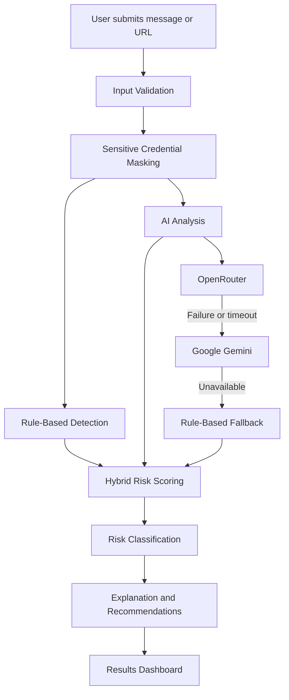
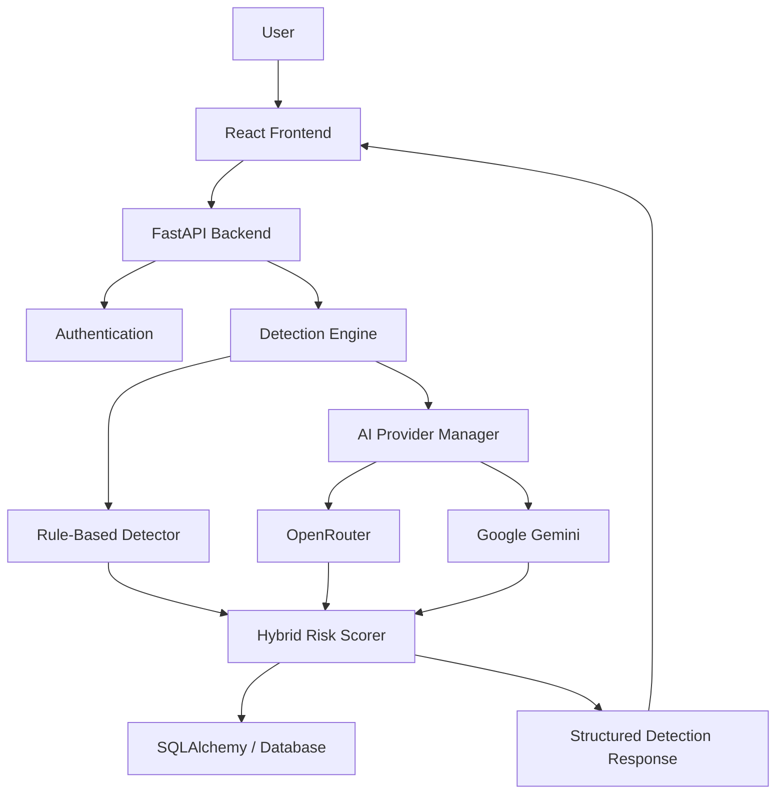

# 🛡️ UPI ScamShield AI
### Detect. Analyze. Protect.

**An AI-powered UPI fraud detection platform that helps people identify suspicious payment messages, phishing attempts, fake cashback offers, and social-engineering scams before they become victims.**

<p align="center">

  
  
  
  
  
  

</p>

---

## 🚨 The Problem

UPI has made digital payments incredibly convenient, but it has also created opportunities for fraudsters to exploit people's trust.

Scammers use increasingly convincing techniques:

- Fake KYC verification messages.
- OTP and UPI PIN harvesting.
- Fake cashback and reward offers.
- Fraudulent payment requests.
- Phishing links disguised as legitimate services.
- Impersonation of banks, customer support, and government services.

Many users cannot easily distinguish a genuine payment notification from a sophisticated scam.

**The challenge isn't just detecting suspicious messages. It's helping people understand WHY something is suspicious before they take action.**

## 💡 Our Solution

**UPI ScamShield AI** is an intelligent fraud-awareness and detection platform that combines rule-based security analysis with AI-powered contextual understanding.

Users can submit suspicious messages or URLs and receive an explainable risk assessment containing:

- A risk score from 0–100.
- Risk classification: Low, Medium, High, or Critical.
- Detected scam category.
- Suspicious indicators and explanations.
- Recommended safety actions.

Instead of simply saying whether something is suspicious, ScamShield helps users understand the warning signs.

## ✨ Key Features

### 🧠 Hybrid AI Fraud Detection
Combines rule-based detection with AI analysis to identify suspicious patterns and contextual scam techniques.

### 🤖 Multi-Provider AI Architecture
Integrates two AI providers in a fixed order:
1. **OpenRouter** – primary provider, used whenever `OPENROUTER_API_KEY` is set.
2. **Google Gemini** – fallback, used when OpenRouter is unavailable or its call fails.
3. **Rule-based + URL analysis** – used when neither provider is configured or both fail.

With neither key set, the backend makes no external AI request at all. Provider fallback and a rule-based detection path keep the API working when AI services are unavailable.

### 📊 Explainable Risk Scoring
Every analysis produces a risk score and corresponding category.

| Risk Score | Classification |
|---|---|
| 0–29 | 🟢 Low |
| 30–59 | 🟡 Medium |
| 60–79 | 🟠 High |
| 80–100 | 🔴 Critical |

*These are heuristic risk bands, not statistically calibrated probabilities.*

### 🔗 Suspicious URL Analysis
Examines URL characteristics and suspicious patterns without automatically opening or visiting submitted URLs.

### 📈 Security Dashboard
Provides an overview of detection activity, risk distribution, and security statistics.

### 🗂️ Detection History
Allows authenticated users to review their previous analyses and track suspicious activity.

### 📚 Scam Awareness Center
Provides educational resources, scam explanations, prevention tips, and guidance for responding to suspected fraud.

### 🔐 Privacy-First Design
- Backend-only AI credentials.
- Sensitive credential masking before AI requests.
- User-specific scan history.
- No automatic visits to suspicious URLs.
- Environment-based secret management.

## ⚙️ How It Works



### Hybrid Risk Scoring

The existing implementation combines rule-based and AI risk scores:

```python
final_score = (rule_score * 0.60) + (ai_score * 0.40)
```

This allows the system to combine recognizable fraud indicators with contextual AI analysis.

The scoring pipeline also preserves structured analysis results and provider information.

## 🏗️ System Architecture



### Technology Stack

| Layer | Technologies |
|---|---|
| Frontend | React, Vite, Tailwind CSS |
| Routing | React Router DOM |
| UI | Lucide React, Recharts |
| API Communication | Axios |
| Backend | Python, FastAPI |
| Validation | Pydantic |
| Database | SQLAlchemy, SQLite |
| Migrations | Alembic |
| AI Providers | OpenRouter (primary), Google Gemini (fallback) |
| AI SDK | Google GenAI, HTTPX |
| Authentication | JWT, Argon2 |
| Testing | Pytest |
| Security Checks | Bandit, pip-audit |
| Version Control | Git, GitHub |

## 📁 Project Structure

```text
UPI-ScamShield-AI/
│
├── backend/
│   ├── app/
│   │   ├── api/
│   │   │   └── routes/
│   │   ├── core/
│   │   ├── database/
│   │   ├── models/
│   │   ├── schemas/
│   │   └── services/
│   │       └── detection/
│   │           ├── openrouter_service.py
│   │           ├── gemini_service.py
│   │           └── ...
│   ├── tests/
│   ├── .env.example
│   └── requirements.txt
│
├── frontend/
│   ├── public/
│   ├── src/
│   │   ├── components/
│   │   ├── context/
│   │   ├── pages/
│   │   ├── services/
│   │   └── ...
│   └── package.json
│
├── docs/
│   ├── PRE_DEPLOYMENT_AUDIT.md
│   └── FINAL_PRE_DEPLOYMENT_AUDIT_REPORT.md
│
├── .gitignore
└── README.md
```

*The structure above summarizes the main project areas; actual filenames may vary.*

## 🚀 Getting Started

### Prerequisites

Install the following:

- Python 3.11 or compatible project-supported version.
- Node.js and npm.
- Git.
- Optional: an OpenRouter and/or Google Gemini API key (without either, the app runs rule + URL analysis only).

### 1. Clone the Repository

```bash
git clone https://github.com/Rajpatel7878/UPI-ScamShield-AI.git
cd UPI-ScamShield-AI
```

### 2. Backend Setup

```bash
cd backend
python -m venv .venv
source .venv/Scripts/activate
pip install -r requirements.txt
```

Create your local environment file:

```bash
cp .env.example .env
```

Configure the required variables in `backend/.env`:

```env
# Optional: OpenRouter is tried first, Gemini is the fallback.
# Leave both empty to run rule + URL analysis only.
OPENROUTER_API_KEY=your_openrouter_api_key
OPENROUTER_BASE_URL=https://openrouter.ai/api/v1
OPENROUTER_MODEL=google/gemini-3.5-flash
OPENROUTER_TIMEOUT_SECONDS=30
OPENROUTER_MAX_RETRIES=2

GEMINI_API_KEY=your_gemini_api_key
```

Keep all API keys private. Never commit `.env` to GitHub.

Start the backend:

```bash
uvicorn app.main:app --reload
```

Backend URL:

```text
http://localhost:8000
```

### 3. Frontend Setup

Open another terminal:

```bash
cd frontend
npm install
```

Configure the frontend API URL using the environment-variable name supported by the existing frontend configuration.

For example:

```env
VITE_API_BASE_URL=http://localhost:8000
```

Start the frontend:

```bash
npm run dev
```

Frontend URL:

```text
http://localhost:5173
```

## 🧪 Testing

### Backend

```bash
cd backend
source .venv/Scripts/activate

python -m compileall app
python -m pytest -q -p no:asyncio
python -m pip check
```

### Frontend

```bash
cd frontend

npm run lint
npm run build
npm audit
```

### AI provider testing

The provider tests are fully mocked: they inject an `httpx.MockTransport` for
OpenRouter and patch the Gemini SDK client, so no real API key is used and no
API credits are consumed. They cover OpenRouter success, OpenRouter failure
followed by Gemini success, both providers failing, neither provider configured,
provider/model metadata and OTP/UPI PIN masking before provider requests.

Live provider behaviour has **not** been verified in this environment because no
AI key is configured here. A deployed instance with a real key must be checked
separately before live AI analysis is claimed.

### Security Testing

The project includes security checks for:

- Sensitive credential masking.
- Prompt-injection resistance.
- User-data isolation.
- API key exposure.
- Passive URL analysis.
- Provider failure handling.
- Structured AI responses.

Run checks using the tools configured in the project.

## 🔒 Security & Privacy

Security is a core design consideration.

UPI ScamShield AI follows these principles:

1. **Secret protection:** AI API keys stay on the backend.
2. **Credential masking:** Sensitive values such as OTPs and UPI PINs are masked before AI requests.
3. **Passive URL analysis:** Submitted URLs are analyzed without automatically visiting them.
4. **User isolation:** Authenticated users can access only their own scan records.
5. **AI input safety:** Submitted messages are treated as untrusted input.
6. **Provider resilience:** AI failures are handled through fallback logic.

**Important:** ScamShield provides risk assessments and awareness guidance. It cannot guarantee that a transaction or message is safe.

If you suspect financial fraud in India, contact your bank immediately and report cyber financial fraud through the official helpline **1930** or [National Cyber Crime Reporting Portal](https://cybercrime.gov.in/).

Never share your UPI PIN or OTP with anyone.

## 📸 Screenshots & Demo

Add real screenshots of your running application here.

| Application | Screenshot |
|---|---|
| Landing Page | `screenshots/landing-page.png` |
| Dashboard | `screenshots/dashboard.png` |
| Scam Detection | `screenshots/detection.png` |
| Analysis Results | `screenshots/results.png` |
| Scam Awareness | `screenshots/awareness.png` |

Replace these placeholders with actual screenshots before submitting the project.

### 🎥 Demo Video

**Project Demo:** Add your public demo video link here.

Recommended demo flow:

1. Introduce the problem.
2. Show the dashboard.
3. Submit a fake KYC scam message.
4. Show the AI analysis and risk score.
5. Submit a normal payment message.
6. Demonstrate detection history.
7. Explain the hybrid AI architecture and privacy protections.

## 🗺️ Future Roadmap

Potential improvements:

- Hindi and Hinglish scam detection.
- Advanced regional-language fraud analysis.
- QR-code payment risk analysis.
- Additional phishing intelligence.
- Real-time scam pattern updates.
- PostgreSQL production deployment.
- Improved model benchmarking.
- More comprehensive browser and accessibility testing.
- Mobile-first experience.

## 🏆 Hackathon Project

**Project:** UPI ScamShield AI  
**Tagline:** Detect. Analyze. Protect.  
**Developer:** Individual Project  
**Event:** Arthaton 2026

Built to explore how AI, explainable risk scoring, and security engineering can help people make safer decisions in the digital payment ecosystem.

## 🤝 Contributing

Contributions, suggestions, and feedback are welcome.

1. Fork the repository.
2. Create a feature branch.
3. Make your changes.
4. Run the relevant tests.
5. Submit a pull request.

## 📜 License

Choose and add an appropriate open-source license before publishing. Until a license is added, the project should not be assumed to grant general reuse permissions.

---

<p align="center">

### 🛡️ UPI ScamShield AI

**Detect. Analyze. Protect.**

*Building a safer digital payment experience with AI.*

</p>
