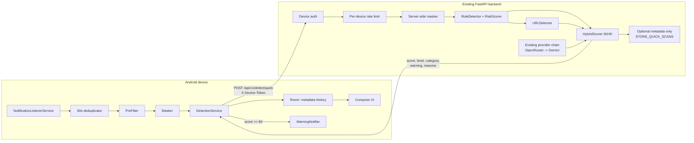

# Android Notification Protection — Implementation Plan (Phase 0)

**Project:** UPI ScamShield AI — *Detect. Analyze. Protect.*
**Document status:** Phase 0 inspection and design only. No application code was modified.
**Baseline commit:** `16fd678` (working tree already contained unrelated local modifications before this document was created).
**Inspection date:** 2026-11-14.

---

## 0. Phase 0 summary

The existing application is a React + Vite SPA backed by a FastAPI service. Detection is
already implemented as a reusable pipeline:

- rule-based detection (`RuleDetector` + `RiskScorer`),
- passive URL analysis (`URLDetector`),
- optional AI providers (`OpenRouter` first, `Gemini` fallback),
- hybrid scoring at 60% rules / 40% AI (`HybridScorer`).

The backend currently has **no device identity, no device-scoped endpoint, and no mobile
quick-analysis contract**. The existing `/api/v1/detect/analyze` endpoint requires a
short-lived user JWT and writes a `Scan` row for every analysis. It is not suitable for
background notification checks because:

1. an Android background listener must not hold a user password or long-lived JWT;
2. the existing endpoint stores analysis records for every call;
3. the existing endpoint has a 10,000-character limit and no 5-second budget;
4. the existing masking function is intentionally broad (`\b\d{4,6}\b`) and is applied
   only before AI calls, not as a shared pre-processing step.

The new work is therefore **additive**:

- a server-issued per-device credential,
- a small, device-authenticated quick-detection endpoint,
- careful Hinglish rule extension,
- a separate `android-app/` project that talks only to that endpoint.

No existing route, scoring weight, threshold, provider order, or database table is replaced.

---

## 1. Repository inspection

### 1.1 Stack and layout

| Area | Findings |
| --- | --- |
| Backend | Python 3.14 local venv, FastAPI 0.162, Pydantic 2.14, SQLAlchemy 2.1, Alembic 1.20, PyJWT, Argon2 |
| Backend layout | `backend/app/{api,core,database,models,schemas,services}`; one Alembic revision |
| Authentication | Stateless JWT (HS256/384/512), Argon2id passwords, `Authorization: Bearer <JWT>` |
| Detection | `app/services/detection/`: rules, normalizer, scorer, explanation, URL analysis, Gemini, OpenRouter, hybrid scorer |
| Database | `users`, `scans`; SQLite locally, PostgreSQL in production; Alembic-managed |
| Frontend | React 19 + Vite + Tailwind in `frontend/`; a second `nextjs-frontend/` also exists but is not the application we are extending |
| CI | `.github/workflows/ci.yml`: compile, Ruff `E9,F`, pytest, Alembic on PostgreSQL, frontend audit/build |
| Deployment | `render.yaml`: `alembic upgrade head` then uvicorn; production requires a strong JWT secret |
| Docs | `docs/ARCHITECTURE.md`, `docs/DEPLOYMENT_ARCHITECTURE.md`, audit/QA reports |

### 1.2 Existing API contracts

| Method | Path | Auth | Persists | Notes |
| --- | --- | --- | --- | --- |
| POST | `/api/v1/auth/register` | none | user | Argon2 password |
| POST | `/api/v1/auth/login` | none | no | returns short-lived JWT |
| GET | `/api/v1/auth/me` | JWT | no | profile |
| POST | `/api/v1/auth/logout` | JWT | no | client-side token removal only |
| POST | `/api/v1/detect/analyze` | JWT | `Scan` row | rules + URL + optional AI + hybrid; max 10,000 chars |
| GET | `/api/v1/detect/history` | JWT | no | paginated, user-scoped |
| GET | `/api/v1/detect/history/{id}` | JWT | no | 404 for another user's scan |
| DELETE | `/api/v1/detect/history` | JWT | deletes own scans | |
| GET | `/api/v1/dashboard/*` | JWT | no | aggregates |
| GET | `/api/v1/health*` | none | no | diagnostics |

Error shape is uniform:

```json
{ "status": "error", "detail": "...", "path": "/api/v1/..." }
```

### 1.3 Detection pipeline as implemented

`POST /detect/analyze` currently does this:

1. `RequestGuardMiddleware`: declared body size ≤ 1 MB, per-IP sliding-window rate limit,
   security headers, `Cache-Control: no-store` on `/api/v1`.
2. `get_current_user`: validates JWT issuer, audience, expiry, type and loads an active user.
3. Pydantic validates `content` (1–10,000) and `content_type`.
4. `RuleDetector.detect()` normalizes and evaluates all rules; `RiskScorer` sums rule
   contributions (capped at 100) and maps to bands.
5. `URLDetector` analyzes links passively; the base score is `max(rule_score, url_score)`.
6. `_analyze_with_ai()` tries OpenRouter first, then Gemini, each off the event loop with a
   35-second hard wall-clock bound; failures return `None`.
7. `HybridScorer.score()` merges AI only when a validated result exists:
   `final = rule_score * 0.60 + ai_score * 0.40`, AI level mapping
   low=15, medium=45, high=70, critical=90.
8. A `Scan` row is written with metadata only (no raw message text).
9. Response includes score, level, category, summary, indicators, recommendations and an
   honest `ai_analysis` status.

**Risk bands are centralized and must not change:**

| Score | Level |
| --- | --- |
| 0–29 | Low |
| 30–59 | Medium |
| 60–79 | High |
| 80–100 | Critical |

### 1.4 Reusable components

| Component | Location | Reuse decision |
| --- | --- | --- |
| `RuleDetector` | `services/detection/rule_detector.py` | Reuse unchanged for quick scans |
| `RiskScorer` | `services/detection/risk_scorer.py` | Reuse unchanged |
| `URLDetector` | `services/detection/url_detector.py` | Reuse unchanged (passive only) |
| `HybridScorer` | `services/detection/hybrid_scorer.py` | Reuse unchanged, including 60/40 weights |
| Provider orchestration | `api/routes/detect.py` private helpers | Reuse through one injected async analyzer; do not clone fallback logic |
| `redact_credentials` | `services/detection/gemini_service.py` | Leave in place for existing AI calls; do **not** reuse as the main masker because it masks every 4–6 digit number |
| `normalize_text` | `services/detection/text_normalizer.py` | Reuse via `RuleDetector` |
| Request guard | `core/middleware.py` | Extend with a small body-size limit for the quick path; keep existing limits |

### 1.5 Gaps and risks found

1. **No device identity.** Only user JWTs exist. JWT logout is explicitly client-side and
   stateless, so a long-lived background listener cannot rely on a JWT.
2. **No device revocation.** JWTs cannot be revoked server-side. A device credential needs
   its own revocable record.
3. **No contact/app metadata in the backend.** Not needed for this feature; quick requests
   will carry only the source package name.
4. **Existing masking is too broad.** `\b\d{4,6}\b` would redact amounts, dates and PIN
   validity minutes. The Android masker and the new backend masker must use context.
5. **Existing tests use ad-hoc in-memory/temp SQLite clients.** There is no `conftest.py`.
   New tests should add shared fixtures without changing existing test behavior.
6. **Stray duplicate file** `backend/backend/app/services/detection/gemini_service.py`
   (130 lines) appears to be an accidental artifact. It is not imported. Do not modify it
   as part of this feature; flag it separately.
7. **Android toolchain is absent in this environment.** `java`, `ANDROID_HOME`,
   `ANDROID_SDK_ROOT` and `gradle` are not available. Backend implementation and tests can
   run here; Android compilation/emulator runs require installing JDK 17 + Android SDK or
   using Android Studio on the developer machine.
8. **The working tree is dirty** with unrelated pre-existing changes. All new work must be
   confined to new files and explicitly listed additions/edits.

### 1.6 Baseline verification

Command run from `backend/`:

```bash
./.venv/Scripts/python.exe -m pytest -q
```

Result: **132 passed, 1 warning** (passlib/argon2 deprecation). No pre-existing test
failures were observed at baseline. This result is only a baseline; it is not evidence for
the new feature.

---

## 2. Proposed architecture

### 2.1 End-to-end flow



### 2.2 Android package architecture

Application ID: `com.upiscamshield.android`. Minimum SDK 26, target/compile SDK current
stable at implementation time. Kotlin + Compose + Gradle Kotlin DSL.

```text
android-app/
├── settings.gradle.kts
├── build.gradle.kts
├── gradle/libs.versions.toml
├── local.properties                 # gitignored; SCAMSHIELD_BASE_URL only
└── app/
    ├── build.gradle.kts
    ├── proguard-rules.pro
    └── src/
        ├── main/
        │   ├── AndroidManifest.xml
        │   ├── res/xml/network_security_config.xml
        │   └── java/com/upiscamshield/android/
        │       ├── ScamShieldApplication.kt
        │       ├── MainActivity.kt
        │       ├── data/
        │       │   ├── local/          # Room database, entity, DAO
        │       │   ├── prefs/          # DataStore settings
        │       │   └── repository/     # history, settings, device, detection
        │       ├── domain/
        │       │   ├── model/          # RiskLevel, DetectionResult, DetectionSource
        │       │   └── usecase/        # analyze notification, enroll device
        │       ├── network/
        │       │   ├── ApiClient.kt    # OkHttp + Retrofit
        │       │   ├── ScamShieldApi.kt
        │       │   ├── dto/            # request/response models
        │       │   └── DeviceAuthInterceptor.kt
        │       ├── security/
        │       │   ├── KeystoreCrypto.kt
        │       │   └── SecureTokenStore.kt
        │       ├── services/
        │       │   ├── ScamNotificationListener.kt
        │       │   ├── NotificationProcessor.kt
        │       │   ├── NotificationDeduplicator.kt
        │       │   └── MonitoringState.kt
        │       ├── notifications/
        │       │   ├── WarningNotifier.kt
        │       │   └── NotificationChannels.kt
        │       ├── utils/
        │       │   ├── Masker.kt
        │       │   ├── PreFilter.kt
        │       │   ├── OfflineRiskAnalyzer.kt
        │       │   └── Hashing.kt
        │       └── presentation/
        │           ├── navigation/
        │           ├── theme/
        │           ├── onboarding/
        │           ├── dashboard/
        │           ├── settings/
        │           ├── history/
        │           ├── detail/
        │           └── components/
        └── test/java/com/upiscamshield/android/   # JVM unit tests
```

Design choices:

- **Manual dependency container** (`AppContainer`) instead of Hilt. Fewer moving parts for a
  hackathon; each layer still depends on interfaces.
- **Room** for local history metadata only. Schema version 1, exported schema.
- **DataStore Preferences** for non-secret settings (monitoring on/off, selected packages,
  sensitivity, warning preferences).
- **Android Keystore + AES-GCM** for the device token. The token ciphertext and IV live in
  DataStore; the key never leaves the Keystore. No `EncryptedSharedPreferences`.
- **Retrofit + OkHttp + Kotlinx Serialization**. Device token added by an interceptor from
  `SecureTokenStore`; the interceptor never logs headers.
- **No JWT persistence.** The enrollment screen uses the existing `/auth/login` JWT once,
  then discards it. The device token is the only long-lived credential.

### 2.3 Backend additions

```text
backend/app/
├── api/routes/
│   ├── devices.py                 # enroll, list, revoke, rotate, self-revoke
│   └── detect.py                  # add POST /detect/quick (keeps existing routes)
├── core/
│   ├── config.py                  # new settings (additive)
│   ├── device_auth.py             # token generation/hash + dependency
│   └── device_rate_limit.py       # per-device sliding window
├── models/
│   ├── device.py                  # Device
│   └── quick_scan_event.py        # optional metadata only
├── schemas/
│   ├── device.py                  # device request/response models
│   └── quick_detection.py         # quick request/response models
└── services/
    ├── privacy/
    │   ├── __init__.py
    │   └── masking.py             # conservative shared masker
    └── detection/
        └── quick_analysis.py      # quick pipeline; injects existing AI analyzer
```

`app/api/__init__.py` registers the devices router. `app/models/__init__.py` imports the new
models so `create_all` and Alembic see them. `app/database/init_db.py` adds the new tables
to `REQUIRED_TABLES` for production schema verification.

Alembic: one new revision creating `devices` and `quick_scan_events`. It must work on both
SQLite and PostgreSQL and must be reversible. No existing table is altered.

---

## 3. Required backend API contracts

### 3.1 Device authentication

**Token format:** `ssdev_` + `secrets.token_urlsafe(32)` (256 bits of entropy).

**Server storage:** SHA-256 hex digest of the complete token in a unique, indexed column.
SHA-256 is appropriate because the token is high-entropy random, not a human password; a
password KDF would only add latency to every notification check. Plaintext is never stored.
The token is returned exactly once.

**Transport:** `X-Device-Token: ssdev_...` on quick-scan requests. This is separate from
`Authorization`, so a device token is never confused with a user JWT and never presented to
browser/CORS flows.

**Lifecycle:** `expires_at` (default 180 days) and `revoked_at`. Rotation replaces the hash
atomically and resets expiry. Revocation is soft (audit-friendly) and takes effect on the
next request.

#### `POST /api/v1/devices/enroll`

Auth: user JWT.

```json
{ "device_name": "Raj's Pixel 8", "platform": "android" }
```

Response `201`:

```json
{
  "device_id": 1,
  "device_name": "Raj's Pixel 8",
  "platform": "android",
  "token": "ssdev_...",
  "token_type": "device",
  "expires_at": "2027-05-13T00:00:00Z"
}
```

`token` appears only in this response and in a rotation response. It is never logged or
listed.

#### `GET /api/v1/devices`

Auth: user JWT. Returns metadata for the caller's devices only: id, name, platform,
created_at, last_used_at, expires_at, revoked_at. No token or hash.

#### `DELETE /api/v1/devices/{device_id}`

Auth: user JWT, owner-scoped. Sets `revoked_at`. Returns `{ "success": true }`.
A different user's device returns `404` (does not confirm existence).

#### `POST /api/v1/devices/{device_id}/rotate`

Auth: user JWT, owner-scoped. Returns a new token once; the old token stops working
immediately. Rotating a revoked device returns `409`.

#### `DELETE /api/v1/devices/me`

Auth: device token. Self-revocation for the Android "Disconnect account" action without
storing a user JWT. Returns `{ "success": true }`.

### 3.2 Quick detection

#### `POST /api/v1/detect/quick`

Auth: `X-Device-Token`. No JWT.

Request (unknown fields rejected):

```json
{
  "text": "Dear customer, your KYC will expire. Verify now at http://... and share OTP 123456",
  "sender": "VM-HDFCBK",
  "source_app": "com.google.android.apps.messaging"
}
```

Validation:

| Field | Rule |
| --- | --- |
| `text` | required, 1–2,000 characters, not whitespace-only, no NUL/control characters |
| `sender` | optional, ≤120 characters, no control characters |
| `source_app` | optional, ≤255 characters, reverse-DNS package pattern (`a.b.c`) |
| body | `Content-Length` for this path ≤ 16 KB; 413 otherwise |
| extras | forbidden (`extra="forbid"`) |

Response `200`:

```json
{
  "risk_score": 85,
  "risk_level": "Critical",
  "category": "Credential Theft",
  "warning_text": "High scam risk. Do not share your OTP or PIN or pay. Verify independently.",
  "reasons": [
    "Asks for an OTP",
    "Mentions KYC or account blocking",
    "Contains a suspicious link"
  ],
  "analysis_type": "hybrid"
}
```

Contract details:

- `risk_score`: integer 0–100; bands unchanged.
- `risk_level`: exactly `Low`, `Medium`, `High`, or `Critical`.
- `category`: taken from the existing pipeline. Rule-only results use the existing rule
  categories (`Credential Theft`, `Fake Verification`, `Pressure Tactic`, `Fake Reward`,
  `Advance Fee`, `Payment Fraud`, `Impersonation`, `Suspicious Link`, `General Scam`).
  When a validated AI result is merged, `HybridScorer` may return the model's category, as
  it already does for `/detect/analyze`; no new taxonomy or competing engine is created.
- `warning_text`: plain language, ≤120 characters, no raw message content, no certainty
  claims such as "definitely fraud".
- `reasons`: 0–3 entries, concise, derived from matched indicators; deduplicated.
- `analysis_type`: additive field for honest source labeling:
  `"hybrid"` = validated AI result merged, `"rule_and_url"` = rules + URL only,
  `"rule_based_only"` = rules only. The Android detail screen uses this to say
  "Online AI-assisted" versus "Online rule-based", never "AI" for a rule-only result.

Status codes:

| Code | Condition |
| --- | --- |
| 200 | analysis completed (AI failure falls back to rules, still 200) |
| 401 | missing, malformed, unknown, revoked or expired device token |
| 413 | oversized quick-scan body |
| 422 | schema/validation failure |
| 429 | >30 quick scans per minute for this device, `Retry-After` set |

### 3.3 Quick pipeline (exact order)

1. Validate `X-Device-Token`; resolve device and active user.
2. Validate the request body and the quick-path size limit.
3. Enforce the per-device rate limit (30/minute).
4. Mask the text with the new conservative masker.
5. Run `RuleDetector` on the masked text (no second rule engine).
6. Run `URLDetector` on the masked text; base score `max(rule, url)` exactly as the existing
   endpoint does. For the quick response, classify the final numeric score with the project
   bands (0–29 Low, 30–59 Medium, 60–79 High, 80–100 Critical); do not expose the separate
   URL-specific High threshold as a message risk level. This satisfies the quick contract
   while leaving the existing `/detect/analyze` behavior untouched.
7. Invoke the existing AI chain only when appropriate:
   - `QUICK_SCAN_AI_ENABLED` is true,
   - at least one provider is configured,
   - base score ≥ 20 **or** a URL was found.
   The call uses the existing OpenRouter → Gemini fallback and a bounded
   `QUICK_SCAN_AI_TIMEOUT_SECONDS` (default 4.5 s). Any timeout/failure returns the rule/URL
   result.
8. If a validated AI result exists, call `HybridScorer.score()` with the same 60/40 formula.
   No weight or threshold is altered.
9. Build warning text and at most three reasons from the final indicators.
10. If `STORE_QUICK_SCANS=true`, write **metadata only**; otherwise write nothing. A storage
    failure must not destroy a completed analysis; it is logged without content.
11. Return the response with `Cache-Control: no-store` (already applied by middleware).

The existing private `_analyze_with_ai` helper in `api/routes/detect.py` is reused by
passing it into the quick service as an injected async callable. This preserves the tested
provider order and avoids a second provider manager. Its signature gains an optional
`timeout` parameter (default remains 35 s), which existing tests already tolerate because
their fake functions accept `timeout=35.0`.

---

## 4. Masking design

New module `backend/app/services/privacy/masking.py`; mirror logic in Android
`utils/Masker.kt`. Both use the same test vectors.

Principles:

- Mask **credential values**, not every number.
- Preserve surrounding words so rule detection still works
  (`"OTP 123456"` → `"OTP [REDACTED]"` still matches the OTP rule).
- Never mask amounts (`Rs 5,000`), dates, OTP validity (`10 minutes`), or ordinary 4–8 digit
  numbers without credential context.
- The replacement token is `[REDACTED]`.

Patterns:

| Type | Trigger | Masked value |
| --- | --- | --- |
| OTP | `OTP`, `o.t.p`, `one-time password`, `verification code`, `authentication code` near 4–8 digits | digits only |
| UPI PIN | `UPI PIN`, `M-PIN`, `MPIN`, or `PIN` with enter/share/verify context near 4–6 digits | digits only |
| Card number | 13–19 digits with optional spaces/hyphens; prefer Luhn-valid or explicit `card` context | whole number |
| CVV | `CVV`/`CVC`/`security code` + 3–4 digits | digits |
| Account number | `a/c`, `account no`, `account number` + 9–18 digits | digits |
| Aadhaar | `Aadhaar`/`Aadhar`/`UID` + 12 digits (optional spaces) | digits |
| Password | `password is/:` followed by a value | value |

Tests include positive cases for each pattern and negative cases for amounts, dates,
validity minutes, order IDs, and ordinary chat numbers. The existing
`redact_credentials()` is **not removed or rewritten**; it remains the final safety net
inside provider services. Because the quick pipeline pre-masks, provider calls receive
already-masked text.

---

## 5. Hinglish rule extension

Rules live in the existing `rules.py` registry. No new detector class. Proposed additions
(all patterns run on normalized lowercase text):

| Rule name | Category | Severity | Points | Examples it should catch |
| --- | --- | --- | --- | --- |
| Hinglish KYC / Account Threat | Fake Verification | high | 20 | `KYC update`, `KYC expire`, `account band ho jayega`, `turant verify karein`, `account suspend` |
| Hinglish OTP / PIN Request | Credential Theft | critical | 35 | `OTP share karein`, `OTP batao`, `PIN enter karo`, `PIN share karein` |
| Hinglish Payment / Refund Scam | Payment Fraud | high | 25 | `UPI payment pending`, `refund claim`, `QR scan karo`, `paise bhejo`, `collect request` |
| Hinglish Reward / Utility Scam | Fake Reward | medium | 15 | `inaam jeeta hai`, `prize money`, `cashback claim karo`, `bijli connection band`, `SIM block` |

False-positive controls:

- Require a compound phrase or a second signal for generic words such as `cashback`,
  `payment`, and `KYC`; do not match them alone.
- Do not match `KYC ho gaya`, `OTP aaya tha`, `payment kar diya`, `bijli ka bill`,
  `Amazon se cashback mila`, or `maine prize jeeta` in ordinary conversation.
- Callbacks may implement positive/negative context checks where regex alone is ambiguous.
- Tests must include both the positive phrase list from the prompt and at least the
  harmless contexts above.

No existing rule, score contribution, category mapping or threshold is changed. New rules
are additive and are counted by the same `RiskScorer`.

---

## 6. Device authentication and security design

### 6.1 Threat model and mitigations

| Threat | Mitigation |
| --- | --- |
| APK decompiled for API keys | No OpenRouter/Gemini keys in the APK; device token is issued per install, not a shared secret |
| Token theft from device backup | Keystore-backed AES-GCM encryption; token ciphertext alone is useless without the device key |
| Token intercepted in transit | HTTPS in production; release build forbids cleartext; debug cleartext only for `10.0.2.2`/localhost |
| Replay of a token | Server-side revocation, expiry, rotation, and rate limiting; token never appears in logs |
| Brute-force token guessing | 256-bit random token; SHA-256 lookup; 401 generic error |
| One user reading another's data | Device rows and optional scan metadata are user-scoped; owner checks return 404 |
| Abuse / notification flooding | 30 requests/min/device with 429; server-side rules still run locally before AI |
| Prompt injection from a notification | Existing AI prompt builder JSON-delimits untrusted text; quick path uses the same providers |
| Credential leakage to AI | Masked on device and again on server before any provider request |
| Malicious backend URL in debug | URL validation; HTTPS required for release; debug only allows configured hosts |

### 6.2 Server-side controls

- Device token hash only, unique index, constant format validation.
- `401` is generic for invalid, revoked and expired tokens; no account enumeration.
- Device endpoints require an active user; a deactivated account cannot use a device token.
- Owner scoping on list/revoke/rotate; cross-user access returns 404.
- Rate limiting is applied after authentication and before detection/AI work.
- Body-size limit for the quick path (16 KB) plus the existing 1 MB global limit.
- Existing security headers and `no-store` remain in force.
- No raw text, token, sender, or authorization header is logged. Access logs contain only
  method, path, status and duration.
- Error responses remain generic; validation errors never echo input values (existing
  handler already strips `input`).

### 6.3 Android controls

- No hard-coded API credentials or AI keys.
- `BACKEND_BASE_URL` comes from `local.properties` (`SCAMSHIELD_BASE_URL`) via `BuildConfig`;
  it is not a secret, but release builds must use HTTPS.
- `network_security_config.xml`: cleartext only for debug (`10.0.2.2`, `localhost`); release
  `cleartextTrafficPermitted="false"`.
- Device token stored with Keystore AES-GCM; never in plain SharedPreferences, logs, or
  crash reports.
- `DeviceAuthInterceptor` adds `X-Device-Token`; logging interceptor (debug only) redacts
  `X-Device-Token` and never logs bodies.
- Timeouts: connect 3 s, read 5 s; no infinite retries. At most one retry for transient
  network errors, then offline fallback.
- `401` clears the stored token and surfaces "Re-enrollment required"; it does not silently
  fall back as if the server had analyzed the message.
- `429` backs off and uses local analysis; no retry storm.
- No automatic blocking, no transaction interception, no accessibility abuse, no bypass of
  Android permission restrictions.

---

## 7. Privacy design

### 7.1 What is read

Only notifications posted by packages the user explicitly selected:

- package name,
- notification title,
- notification text / big text (whichever is exposed),
- post timestamp.

The app does not read app databases, private conversations, attachments, images, contact
lists (except an optional local sender-name match), or notifications from unselected apps.
It ignores its own notifications, ongoing notifications, and group summaries.

### 7.2 What leaves the device

After local pre-filtering and masking:

- masked message text (≤2,000 characters),
- optional sender/title string,
- source application package name.

No OTPs, PINs, card numbers, passwords, account numbers, contact lists, images, or raw
unmasked text are sent. The server re-masks before rules/AI. AI providers see only masked
text.

### 7.3 What is stored

- **Device (default):** Room row with risk score, level, category, source app, timestamp,
  detection source, warning text and reasons. No raw notification text. Retained until the
  user clears history.
- **Server (default `STORE_QUICK_SCANS=false`):** nothing.
- **Server (if explicitly enabled):** risk score, level, category, source app, timestamp,
  device id, user id. No text, no sender, no masked text.
- **Device token:** Keystore-encrypted ciphertext only.
- **Settings:** monitoring state, selected packages, sensitivity, warning preferences.

This version does not implement raw-text history at all, not even as an opt-in.

### 7.4 User controls

- Explicit consent before enabling notification access; monitoring is never auto-enabled.
- Per-app monitoring toggles; pause/resume from dashboard and settings.
- Sensitivity selection.
- Optional "skip saved contacts" requires an explicit action before `READ_CONTACTS` is
  requested; if denied, the feature stays off and detection continues.
- Notification preferences and warning minimum level (High/Critical).
- Clear local history.
- Revoke device access (self-revoke) and disconnect account (clear token and local data with
  confirmation).
- Link to privacy explanation from onboarding and settings.

### 7.5 Limitations to state in the app and docs

- Notification access exposes only what an app chooses to post; some apps hide content or
  show "New message". The app cannot guarantee coverage of every message or conversation.
- Detection is heuristic; false positives and false negatives are possible. It never claims
  to detect every scam.
- Offline analysis is local rules only and is labeled as such; it is not an AI result.
- Contact matching is best-effort because notification titles are not always contact names.
- In-memory rate limiting is per backend worker; multi-worker deployments need a shared
  store (Redis) for a globally exact limit.

---

## 8. Android feature design

### 8.1 Notification listener

`ScamNotificationListener : NotificationListenerService`

`onNotificationPosted`:

1. Ignore own package.
2. Ignore ongoing notifications (`FLAG_ONGOING_EVENT`, `FLAG_FOREGROUND_SERVICE`) and group
   summaries.
3. Check persisted monitoring enabled / paused and selected package.
4. Extract title, text, big text, subtext; if all empty, ignore.
5. Compute SHA-256 of `package + title + text`; drop if the same hash was processed within
   60 seconds. Cleanup runs opportunistically; the map is bounded.
6. Optionally skip if the title matches a saved contact and the user enabled that feature.
7. Run `PreFilter`. If it declines, stop (no network, no warning).
8. Run `Masker`; the network request uses only masked text.
9. Call `DetectionService` on an application-scoped coroutine.
10. Persist metadata, then notify if score ≥ 60.

### 8.2 PreFilter

Runs locally and returns `shouldSend`, matched signal names, and a local score. Signals:

- URL present,
- OTP / one-time password / verification code language,
- UPI / payment / collect / refund / cashback / lottery / prize,
- PIN / KYC / account block / suspend / SIM block / electricity disconnection,
- urgency (`urgent`, `immediately`, `turant`, `abhi`),
- Hinglish equivalents from the backend rule list.

Sensitivity:

| Sensitivity | Forward when |
| --- | --- |
| High | any strong signal, or two weak signals |
| Medium (default) | a credential/payment signal, or a URL plus any signal, or three weak signals |
| Low | credential request, or payment + urgency, or a suspicious URL plus payment language |

Ordinary personal messages and normal bank balance alerts must not be forwarded. The
PreFilter is deliberately conservative; its thresholds are documented and unit-tested.

### 8.3 Masker

Kotlin implementation of the same conservative patterns as the backend. Unit tests cover:

- `Your OTP is 482913` → code hidden,
- `UPI PIN 1234` / `PIN enter karo 1234` → PIN hidden,
- `Card 4111 1111 1111 1111` → card hidden,
- `Rs 5,000`, `within 10 minutes`, `order 123456`, `meeting at 4:30` → unchanged,
- mixed Hindi/Hinglish text,
- idempotence (masking twice does not corrupt the text).

### 8.4 API client and offline fallback

`ApiClient`:

- Retrofit base URL from `BuildConfig.BACKEND_BASE_URL`.
- OkHttp connect 3 s, read 5 s, one retry on `IOException` only.
- `DeviceAuthInterceptor` reads the token from `SecureTokenStore`.
- Response DTO validated: score 0–100, level in the four allowed values, reasons ≤3.
- `401` → clear token + `ReEnrollmentRequired`; `429` → back off; `5xx`/timeout → offline.

`OfflineRiskAnalyzer`:

- Reuses the same local signal tables as `PreFilter` with a small weighted score.
- Returns `DetectionSource.OFFLINE_LOCAL`.
- The UI says "Offline local rules — not an AI analysis."
- Never claims verified fraud classification.

### 8.5 WarningNotifier

- Channel `scam_warnings`, importance HIGH, vibration, lockscreen `VISIBILITY_PRIVATE`.
- Notify only for score ≥ 60.
- Public/lockscreen content: "Possible UPI scam detected" + risk level only. No message text,
  sender, OTP, or URL.
- Tap opens the detection detail screen (local history id).
- Detail screen shows score, level, category, warning, reasons, source (online AI-assisted /
  online rule-based / offline local), and safety guidance:
  - never share OTP or UPI PIN,
  - never approve unknown collect requests,
  - verify payment requests independently,
  - cybercrime helpline 1930,
  - https://cybercrime.gov.in/.
- No automatic blocking of messages, transactions, or apps.

### 8.6 Screens

1. **Onboarding / consent** — what notification access means; which apps can be monitored;
   what is sent; on-device masking; what is stored; pause/disable; consent checkbox; open
   notification-access settings; continue; skip (monitoring stays off).
2. **Enrollment** — backend URL display, existing email/password login used once for
   `/devices/enroll`, success shows device name/expiry; JWT discarded.
3. **Dashboard** — protection status, monitoring status, recent warnings, total checks,
   high-risk count, pause/resume, settings shortcut. Data comes from Room only.
4. **Settings** — backend URL (dev), device status, per-app toggles, sensitivity, skip saved
   contacts, pause, notification preferences, privacy, revoke device, disconnect account.
5. **History** — Room-backed list of metadata, newest first; clear-history action.
6. **Detection details** — as described above.

### 8.7 App selection

Curated defaults: SMS, WhatsApp, Telegram. Installed-state checks for known packages.
Additional monitorable apps are discovered with a narrow `<queries>` declaration for apps
that handle `ACTION_SEND` text/plain (no `QUERY_ALL_PACKAGES`). The user can add/remove
packages; the listener always re-checks the persisted selection. Unselected apps are ignored
even if they post notifications.

---

## 9. Development phases and exit criteria

Work strictly in this order. Do not start Android before Phase 7 is verified.

| Phase | Work | Exit criteria |
| --- | --- | --- |
| 0 | Repository inspection and this plan | This document; no code changes |
| 1 | Backend device authentication | Models, migration, endpoints, hashing, revocation, tests |
| 2 | Backend quick detection endpoint | Contract, validation, device auth dependency, error codes |
| 3 | Masking + quick pipeline | Conservative masker, rule reuse, AI gating, hybrid reuse |
| 4 | Hinglish rules | Additive rules; positive and harmless-context tests |
| 5 | Rate limiting + storage flag | 30/min/device, 429, default no persistence, optional metadata |
| 6 | Backend tests and security review | New tests + existing suite green; compile, Ruff, Bandit, pip-audit reported |
| 7 | Backend curl verification | Enroll, quick scan, 401, 422, 429, no raw content in DB |
| 8 | Android project initialization | Gradle KTS, Compose, min SDK 26, BuildConfig URL, manifest skeleton |
| 9 | Android security and networking | Keystore token store, API client, interceptor, timeouts, 401/429 handling |
| 10 | Local filtering and masking | `PreFilter`, `Masker`, unit tests passing |
| 11 | Notification listener | Consent-gated listener, dedup, selection, pause, contacts opt-in |
| 12 | Warning notifications | Channel, lockscreen privacy, threshold, detail intent, safety guidance |
| 13 | Compose screens | Onboarding, dashboard, settings, history, detail |
| 14 | Room history | Metadata-only entity/DAO, retention, clear history |
| 15 | Android tests | JVM unit tests; manual real-device guide |
| 16 | Documentation | README update, `ANDROID_SETUP.md`, `ANDROID_TESTING.md`, `ANDROID_PRIVACY.md` |
| 17 | End-to-end verification | Backend + emulator/device flow; report actual results and limitations |

After each phase: list files created/changed, explain what was implemented, run the relevant
checks, and report failures without hiding pre-existing ones.

---

## 10. Testing strategy

### 10.1 Backend tests

New test files (pytest, temp SQLite, dependency overrides, no network):

- `tests/conftest.py` — opt-in fixtures only; no autouse behavior that could alter existing
  tests.
- `tests/test_device_auth.py` — enrollment, token shown once, hash storage, list redaction,
  missing/malformed/invalid token, revoked token, expired token, rotation, self-revoke,
  cross-user isolation.
- `tests/test_quick_detection.py` — valid request, missing auth, invalid input, blank text,
  2,000-char boundary and 2,001-char rejection, NUL/control characters, invalid source app,
  unknown fields, oversized body (413), response constraints, risk-level bands.
- `tests/test_masking.py` — OTP, PIN, card, CVV, account, Aadhaar, password, and negative
  cases (amounts/dates/order IDs).
- `tests/test_quick_ai.py` — rule-only when no provider, AI-assisted with mocked provider,
  OpenRouter failure → Gemini fallback, both fail → rule result, timeout → rule result.
- `tests/test_quick_rate_limit.py` — exactly 30 allowed, 31st 429, `Retry-After`, different
  devices independent, limiter reset for tests.
- `tests/test_quick_privacy.py` — default no DB writes, flag=true metadata only, no text or
  sender column/value, user/device isolation.
- `tests/test_hinglish_rules.py` — all prompt phrases detected; harmless contexts not
  detected; existing English rules unchanged.

Run:

```bash
cd backend
./.venv/Scripts/python.exe -m compileall -q app
./.venv/Scripts/python.exe -m pytest -q
./.venv/Scripts/python.exe -m ruff check app tests
```

Then, if installed (otherwise report as unavailable, do not fake):

```bash
./.venv/Scripts/python.exe -m bandit -r app -q
./.venv/Scripts/python.exe -m pip_audit
```

Existing tests must remain green. Pre-existing failures, if any appear, are reported
separately and not “fixed” by weakening tests.

### 10.2 Manual backend curl checks

- login → enroll → save token once,
- quick scan with valid token,
- quick scan without token → 401,
- revoke → same token → 401,
- 2,001 chars → 422,
- 31 rapid requests → 429,
- inspect SQLite for the token hash (not plaintext) and no raw message text,
- with AI keys absent, confirm `analysis_type` is rule-only and no external call occurs.

### 10.3 Android tests

JVM unit tests:

- `PreFilterTest` — suspicious vs ordinary messages, sensitivity levels.
- `MaskerTest` — positive/negative vectors shared with the backend.
- `NotificationDeduplicatorTest` — duplicate within 60 s suppressed; after window allowed.
- `RiskThresholdTest` — 59 no warning, 60 warning, bands.
- `OfflineRiskAnalyzerTest` — deterministic local score and source label.
- `WarningTextTest` — ≤120 chars, no raw content.
- DTO serialization tests for the quick response.

Instrumented/manual:

- Room DAO in-memory test.
- Keystore token store on a real device/emulator (Keystore behavior is not fully available
  on JVM).
- Compose screens checked visually on emulator/device; no exhaustive UI automation by
  default.

Manual real-device guide (10 scenarios from the prompt):

1. fake KYC notification,
2. OTP-sharing request,
3. suspicious payment link,
4. normal bank notification (no warning),
5. normal personal message (no request),
6. duplicate notification (one warning),
7. backend unavailable (offline local result, labeled),
8. monitoring paused (no request/warning),
9. unselected app notification (ignored),
10. sensitive masking (no OTP/PIN in request; verify with a local proxy).

No real OTPs, PINs, or banking credentials are used in tests. Use fake values such as
`482913` and `1234` in synthetic notifications only.

### 10.4 End-to-end acceptance

- Enroll from a debug build against `http://10.0.2.2:8000/api/v1/`.
- Receive a synthetic suspicious notification → backend called → warning at ≥60.
- Receive a normal message → no backend call (PreFilter) and no warning.
- Stop the backend → offline result labeled correctly.
- Pause monitoring → no calls.
- Revoke the device → next check gets 401 and the app asks to re-enroll.
- Confirm backend DB contains no raw text and no plaintext device token.

---

## 11. Documentation deliverables (later phases)

- `docs/ANDROID_PRIVACY.md` — all privacy points in section 7.
- `docs/ANDROID_SETUP.md` — exact backend, Android Studio, emulator, real-device, ngrok and
  cloudflared commands.
- `docs/ANDROID_TESTING.md` — automated and manual test instructions.
- `README.md` — project overview, existing web architecture, new Android architecture,
  Mermaid diagram, setup, enrollment, testing, privacy model, permissions, demo script.
- Final report — architecture, file lists, endpoints, security/privacy measures, actual test
  results, limitations, commands, real-device steps, demo script.

---

## 12. Decisions and assumptions to confirm before Phase 1

These are the only design choices that are not fully dictated by the prompt:

1. **`analysis_type` is added to the quick response** so the app can honestly label
   AI-assisted versus rule-only online results. It is additive and does not break the five
   required fields.
2. **Device token lifetime defaults to 180 days**, with rotation and immediate revocation.
   If you prefer a different lifetime, it is one setting.
3. **AI is skipped for quick scans when the base rule/URL score is below 20** and called with
   a 4.5-second bound otherwise. This keeps the 5-second budget and avoids sending ordinary
   notifications to a provider.
4. **Rate limiting remains in-process** (30/min/device per worker) with the multi-worker
   limitation documented; no Redis is added in this version.
5. **Android enrollment uses the existing email/password login once** to obtain a JWT, then
   discards it and stores only the device token. Re-enrollment/rotation requires logging in
   again; self-revoke uses the device token.
6. **Android compilation cannot be verified in this environment yet** because no JDK,
   Android SDK, Gradle, or emulator is installed. I can scaffold the project and write unit
   tests, but actual APK compilation and real-device checks require the toolchain (or your
   Android Studio machine). Installing the SDK is a large download and will be requested
   before Phase 8 rather than done silently.

No backend or Android code will be written until Phase 0 is accepted. Phase 1 starts with
the device model, migration and enrollment endpoints.
